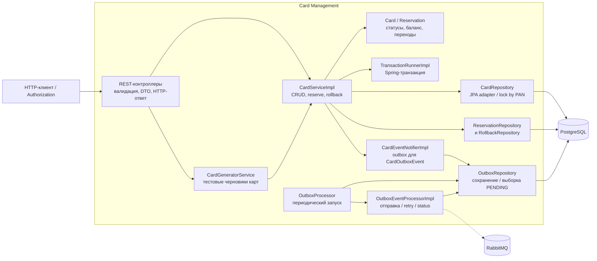

# А3. Компоненты Card Management — C4 Level 3

Выбран Card Management: здесь сходятся резервирование, блокировки БД и outbox. Схема показывает прикладные компоненты, а не все DTO и mapper-классы.

`reserve`, `rollback`, `patchCard` и `deleteCard` выполняют изменения через `TransactionRunner`. Для reserve блокируется карта, создаётся резерв, меняется баланс и сохраняется событие. Атомарность этих записей проверяется с настоящей PostgreSQL; Mockito не доказывает rollback Spring-транзакции.

`Card.startReservation` проверяет ACTIVE и достаточный баланс без сети и БД — это unit-граница. `Card.withReservation` уменьшает баланс и проверяет соответствие PAN; `Reservation.startRollback` запрещает повторный откат. Наличие PostgreSQL-блокировки проверяется отдельно от этих чистых правил.

Outbox доставляется позже отдельным запуском планировщика. Обработчик считает успешным возврат `convertAndSend`, сохраняет PROCESSED, при исключении увеличивает retryCount и после настроенного предела ставит FAILED. В текущей реализации нет ожидания publisher confirm и отдельного экспоненциального backoff. Поэтому PROCESSED само по себе не доказывает сохранение уведомления потребителем.

Источники: [CardServiceImpl](../../../services/card-management/src/main/java/com/processing/cardmanagement/services/CardServiceImpl.java), [Card](../../../services/card-management/src/main/java/com/processing/cardmanagement/models/Card.java), [Reservation](../../../services/card-management/src/main/java/com/processing/cardmanagement/models/Reservation.java), [TransactionRunnerImpl](../../../services/card-management/src/main/java/com/processing/cardmanagement/services/TransactionRunnerImpl.java), [CardEventNotifierImpl](../../../services/card-management/src/main/java/com/processing/cardmanagement/events/CardEventNotifierImpl.java), [OutboxProcessor](../../../services/card-management/src/main/java/com/processing/cardmanagement/services/OutboxProcessor.java), [OutboxEventProcessorImpl](../../../services/card-management/src/main/java/com/processing/cardmanagement/services/OutboxEventProcessorImpl.java).
