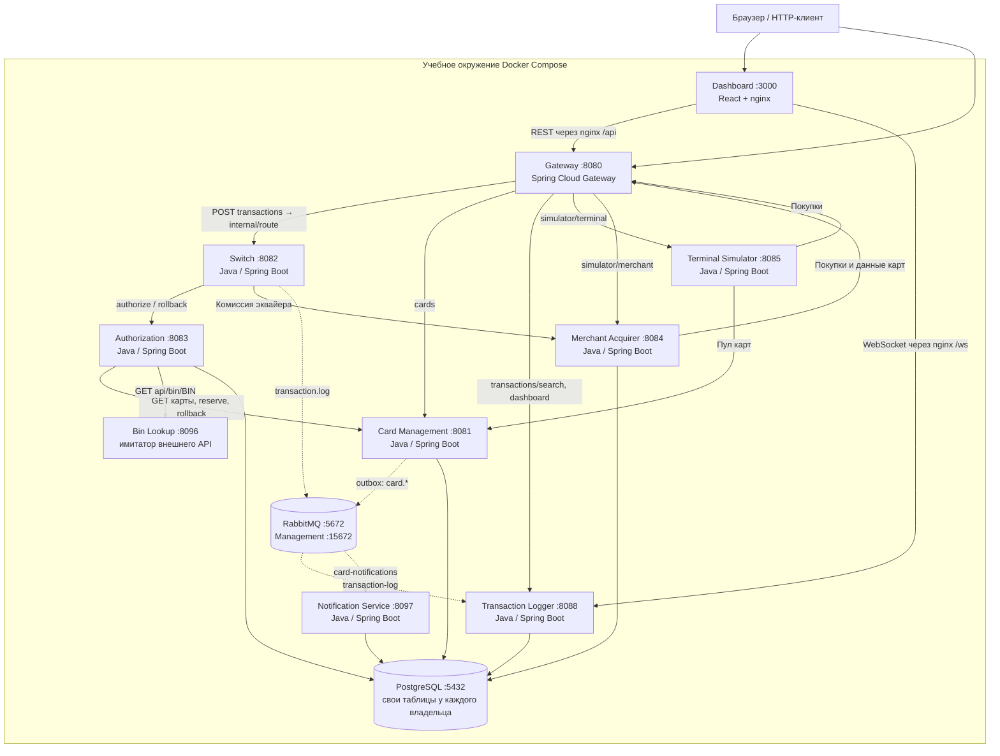

# А2. Контейнеры — C4 Level 2

Порты ниже опубликованы на хосте. Внутри Compose Java-приложения слушают 8080; HTTP-клиенты используют имена сервисов. Сплошная стрелка — синхронный вызов или JDBC, пунктир — AMQP-доставка.

Базовый стенд содержит 10 приложений и два инфраструктурных контейнера. Autoscaler, Prometheus, Grafana, Loki и Promtail запускаются профилем `observability` и в бизнес-цепочку этой схемы не входят. Формулировка «11 сервисов» в старом чек-листе не совпадает с базовым Compose.

Пять сервисов обращаются к PostgreSQL: CMS, Authorization, Merchant Acquirer, Logger, Notification. Один инстанс БД не означает разрешение читать чужие таблицы в коде приложения. Таблицы, например `cards`, `limit_usage`, `transactions`, принадлежат разным сервисам; тестовые SQL-снимки служат наблюдению.

Источники: [Compose](../../../docker-compose.yaml), [маршруты Gateway](../../../services/gateway/src/main/resources/application.yml), [nginx Dashboard](../../../services/dashboard/nginx.conf), [RoutingService](../../../services/switch/src/main/java/com/processing/service/RoutingService.java), [клиент комиссии](../../../services/switch/src/main/java/com/processing/service/AcquiringFeeClient.java), [CardProvider Merchant](../../../services/merchant-acquirer/src/main/java/com/processing/merchantacquirer/service/CardProvider.java).

Границы для тестирования: HTTP-контракты Gateway/Switch — API; SQL, AMQP и транзакции отдельного сервиса — integration; покупка через Gateway с наблюдением результата в Dashboard — E2E. Тест связи двух сервисов не становится E2E только из-за наличия HTTP.
