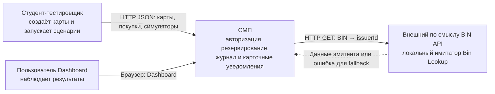

# А1. Контекст системы — C4 Level 1

СМП имитирует обработку покупки и предоставляет сведения о результате. Студент запускает синтетическую нагрузку, управляет картами и проверяет журнал. Внешние банки и платёжные сети к стенду не подключены.

Граница здесь логическая: Bin Lookup изображён внешним поставщиком справочных данных. В учебном окружении он поставляется тем же Compose; на А2 показано всё развёртывание. PostgreSQL и RabbitMQ — внутренние технические зависимости, поэтому на уровне контекста они не вынесены в самостоятельные бизнес-системы. Симуляторы входят в СМП и не обозначают реальные терминалы или эквайеров.

Основание: [README](../../../README.md), [Compose](../../../docker-compose.yaml), [BinLookupClient](../../../services/authorization/src/main/java/com/processing/authorization/client/BinLookupClient.java). По последнему клиенту можно отдельно проверить контракт и fallback; доступность внешнего справочника не должна превращать все покупки в E2E-тесты отказа.
