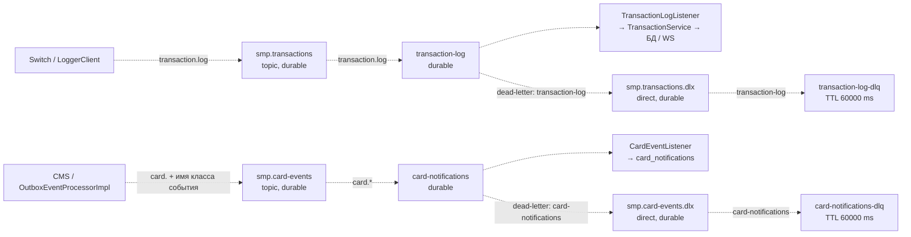

# А5. Топология RabbitMQ и границы гарантий

| Поток | Публикация и полезная нагрузка | Обработка |
|---|---|---|
| Транзакции | `TransactionRequest` с UUID id, RRN, PAN, суммой и результатом | Повтор того же id и данных возвращает существующую запись; конфликт данных вызывает исключение |
| Карточные события | Например `card.CardServicePatchEvent`; событие сохраняется сначала в outbox | Notification извлекает тип из routing key, разбирает JSON и сохраняет уведомление |
| Dead letters | Основные очереди задают DLX, dead-letter routing key и `x-max-delivery=3` | Очереди DLQ имеют TTL 60 с; автоматическая обратная доставка из них в основные очереди в коде не настроена |

Топология транзакций объявляется Switch и Logger, карточных событий — CMS и Notification. Switch объявляет также transaction DLX/DLQ; Logger повторяет только основной exchange, очередь и binding. Отдельный запуск Logger не равнозначен запуску полной топологии.

Три разные гарантии нельзя объединять в одну:

1. Возврат `convertAndSend` показывает завершение клиентского вызова. Настройки `publisher-confirm-type=correlated` и `publisher-returns=true` сами по себе не заменяют проверку ack/return: в обоих publisher-классах нет ожидания confirm.
2. `x-max-delivery=3` присутствует в QueueBuilder, но точное число доставок и уход в DLQ надо проверить с реальным брокером и настройками listener. Это не Java-счётчик retry и не доказательство трёх попыток обработки.
3. Идемпотентность Logger по id не равна идемпотентности всей покупки. Повтор внешнего POST создаёт новый UUID в Switch. Для Notification явной дедупликации событий в listener нет; проверка «ровно одно уведомление при любых повторах» пока не согласована.

Предлагаемые integration-проверки: одинаковые декларации топологии; повторная доставка транзакции; poison message в каждом потоке; истечение TTL в DLQ; ошибка записи outbox; недоступный брокер. На E2E оставляем клиентский финансовый результат и появление покупки в журнале.

Источники: [Switch RabbitMQConfig](../../../services/switch/src/main/java/com/processing/config/RabbitMQConfig.java), [Logger RabbitMQConfig](../../../services/transaction-logger/src/main/java/com/processing/transactionlogger/config/RabbitMQConfig.java), [CMS RabbitMQConfig](../../../services/card-management/src/main/java/com/processing/cardmanagement/config/RabbitMQConfig.java), [Notification RabbitMQConfig](../../../services/notification-service/src/main/java/com/processing/notification/config/RabbitMQConfig.java), [TransactionLogListener](../../../services/transaction-logger/src/main/java/com/processing/transactionlogger/listener/TransactionLogListener.java), [CardEventListener](../../../services/notification-service/src/main/java/com/processing/notification/listener/CardEventListener.java).
