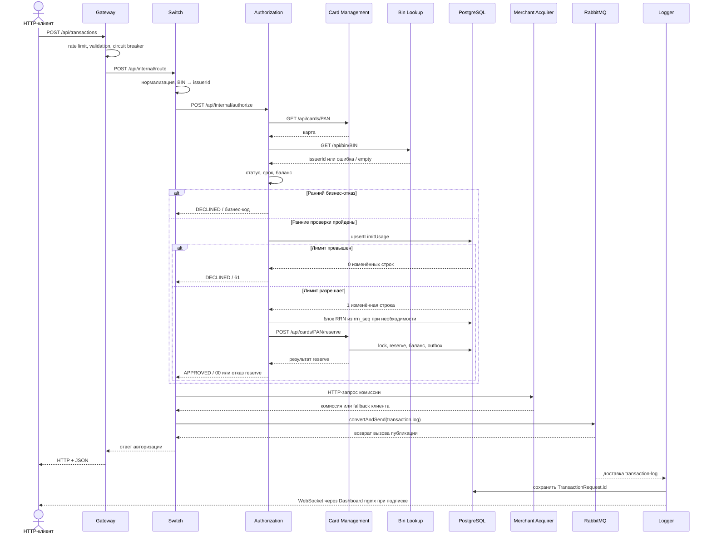
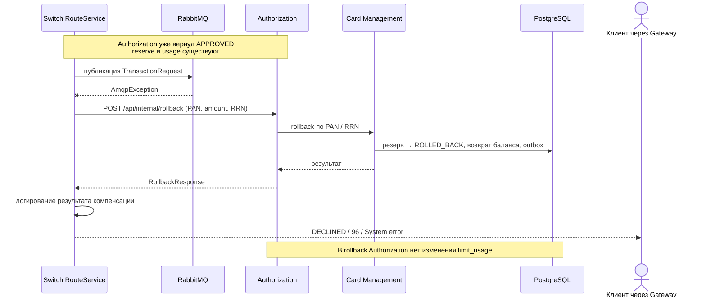

# А4. Последовательности покупки и компенсации

Схемы описывают текущие вызовы. Требования к неизменности денег и лимитов проверяются отдельно: наличие стрелки rollback не означает успешное восстановление состояния.

## Покупка и бизнес-отказ

Доставка в Logger может произойти до или после клиентского ответа; между ними нет гарантированного порядка. Сбой Bin Lookup допускает продолжение, но в `AuthServiceImpl` полученный issuerId сейчас только логируется. Ранний выход при ошибке GET CMS происходит до обращения к Bin Lookup и не показан отдельной веткой для компактности. Неизвестный BIN Switch отклоняет ещё до Authorization, затем также пытается записать отказ в очередь.

## Сбой публикации после одобрения

Если LoggerClient вернул false для исходного DECLINED, Switch не вызывает rollback и возвращает исходный отказ. В ветке APPROVED клиентский код 96 не доказывает успешную компенсацию: Switch логирует её результат, а тело ответа остаётся системной ошибкой. Сохранение usage при отказе reserve и невосстановление usage при rollback — риски для тестов, а не подтверждённые результаты прогона.

Источники: [RouteService](../../../services/switch/src/main/java/com/processing/service/RouteService.java), [LoggerClient](../../../services/switch/src/main/java/com/processing/service/LoggerClient.java), [AuthServiceImpl](../../../services/authorization/src/main/java/com/processing/authorization/services/AuthServiceImpl.java), [LimitUsageRepository](../../../services/authorization/src/main/java/com/processing/authorization/repositories/LimitUsageRepository.java), [CardServiceImpl](../../../services/card-management/src/main/java/com/processing/cardmanagement/services/CardServiceImpl.java), [TransactionService](../../../services/transaction-logger/src/main/java/com/processing/transactionlogger/service/TransactionService.java).
