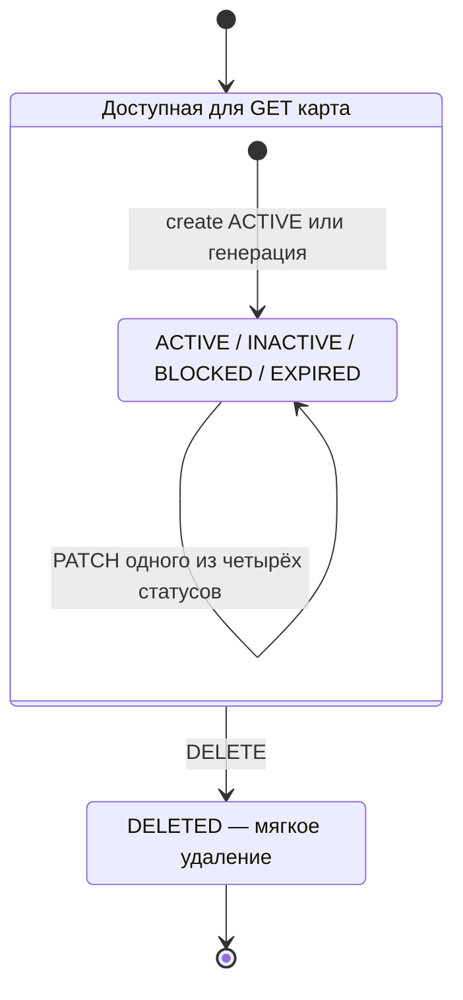
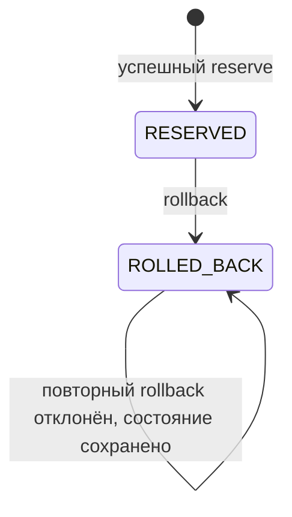
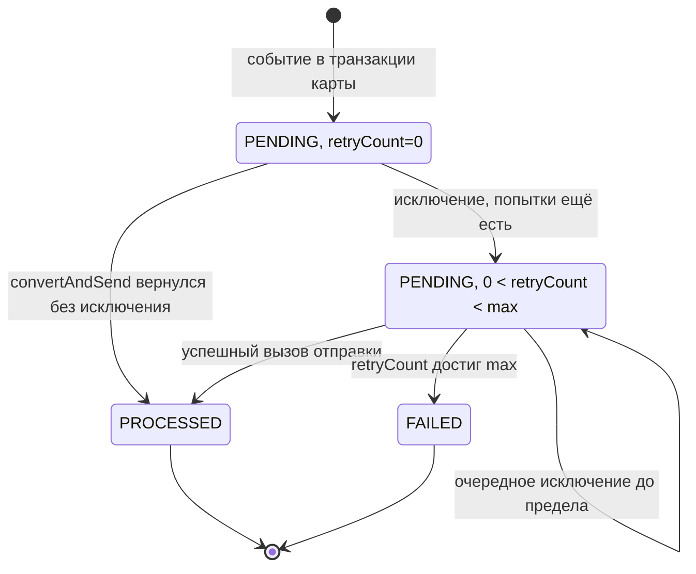

# А6. Переходы состояний

## Карта

PATCH не задаёт матрицу разрешённых переходов между четырьмя пользовательскими статусами. Например, BLOCKED → ACTIVE допускается реализацией. DELETED отсутствует в `CardModelStatus`, задаётся отдельным DELETE и скрывается `@SQLRestriction` в `CardEntity`. Проверять скрытие нужно с БД, а не только вызовом `Card.deleted`.

Истечение срока не изображено стрелкой ACTIVE → EXPIRED: код Authorization отклоняет просроченную карту независимо от её текущего статуса. Автоматическая смена статуса по календарю в рассмотренной цепочке отсутствует. `startReservation` разрешён только ACTIVE; для остальных статусов выбрасывается `IllegalStateException`.

## Резерв и бизнес-решение

APPROVED и DECLINED — статусы ответа и записи транзакции; ROLLED_BACK — статус резерва CMS. Их нельзя считать тремя состояниями одного enum. При успешной авторизации баланс уже уменьшен резервированием; при компенсации CMS возвращает сумму. Отказ до reserve не создаёт резерв. Сбой доставки уже одобренной покупки не гарантирует появления отдельной записи об откате в Logger.

## Outbox

По умолчанию max=3 и интервал планировщика 1000 мс; эти параметры переопределяются окружением. PROCESSED относится к работе publisher, получение события Notification проверяется отдельно. Отказ транзакции карты должен откатить и исходную строку PENDING.

Источники: [CardStatus](../../../services/card-management/src/main/java/com/processing/cardmanagement/models/CardStatus.java), [CardModelStatus](../../../services/common/src/main/java/com/processing/common/dto/cardmanagement/CardModelStatus.java), [CardEntity](../../../services/card-management/src/main/java/com/processing/cardmanagement/models/CardEntity.java), [Card](../../../services/card-management/src/main/java/com/processing/cardmanagement/models/Card.java), [Reservation](../../../services/card-management/src/main/java/com/processing/cardmanagement/models/Reservation.java), [TransactionStatus](../../../services/common/src/main/java/com/processing/common/dto/transactionlogger/TransactionStatus.java), [CardOutboxEventData](../../../services/card-management/src/main/java/com/processing/cardmanagement/models/CardOutboxEventData.java), [OutboxEventProcessorImpl](../../../services/card-management/src/main/java/com/processing/cardmanagement/services/OutboxEventProcessorImpl.java), [настройки CMS](../../../services/card-management/src/main/resources/application.properties).
