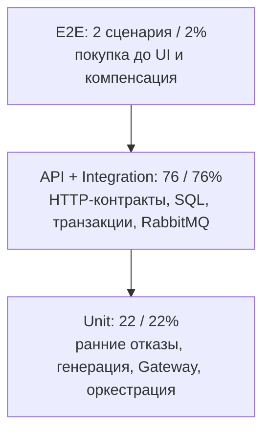

# Г. Анализ пирамиды и план автоматизации

## Подсчёт

Единица — строка с уникальным ID в [классификации](classification.md) и [новых кейсах](test-cases.md). Для новых кейсов уровень задан разделом; для прежних — столбцом таблицы. Один параметризованный ID считается один раз. Чек-листы SM/CP, архитектурные схемы и исходные TSV/CSV с теми же кейсами повторно не учитываются. Сценарии не выполнялись; проценты характеризуют проектируемый набор.

| Уровень | Практика 2 | Новые | Всего | Доля |
|---|---:|---:|---:|---:|
| Unit | 16 | 6 | 22 | 22% |
| API | 17 | 4 | 21 | 21% |
| Integration | 49 | 6 | 55 | 55% |
| E2E | 0 | 2 | 2 | 2% |
| **Итого** | **82** | **18** | **100** | **100%** |

Для трёхслойной пирамиды API и integration объединяются: **22% / 76% / 2%**. Ориентир70/20/10 используется для сравнения, а не как обязательная квота или доказательство качества.

Схема обозначает уровни, её ширина не кодирует количество. Числа из таблицы показывают широкую середину и узкое unit-основание. Это не перевёрнутая пирамида с преобладанием E2E; основной дисбаланс — высокая стоимость интеграционного слоя.

## Почему получилось такое распределение

1. Практика 2 сосредоточена на Authorization/CMS и явно требует проверять сохранённый баланс, usage, reserve и поля карты. Уменьшить49 integration до unit простой заменой repository на Mockito нельзя: будут потеряны исходные оракулы commit, блокировки и ограничений БД.
2. Дневной и месячный лимиты находятся в PostgreSQL-запросе `upsertLimitUsage`. Параметризованный Java-тест с `thenReturn(0)` полезен для выбора decline-кода, но не проверяет `<=`, переход месяца или накопление расходов. Поэтому PW-A-004/007/011/015 и положительные граничные строки остаются integration.
3. Часть ограничений живёт ниже Java DTO: длина имени в колонке, уникальность PAN/резерва, Hibernate-фильтр DELETED, блокировки и последовательность RRN. Их нельзя приписать unit-покрытию только потому, что тест вызывает один метод.
4. Новые API-срезы специально отделены от БД: P3-10 проверяет409 от обработчика ошибок, а P3-13 — реальную идемпотентность и конфликт данных. Первый не заменяет второй; они ловят разные дефекты.
5. Два E2E оставлены на доказательство результата для пользователя и денежной компенсации. Статусы, даты, суммы и варианты JSON уже проверяются ниже. Поэтому E2E меньше условных10%, но это не причина добавлять восемь одинаковых покупок ради пропорций.

## Риски и что с ними делать

| Приоритет | Риск | Проверка / действие |
|---|---|---|
| P1 | Отказ reserve или компенсация расходует usage без покупки | TC-A-14 и P3-18: снимки limit_usage, баланс и резерв; статическое наблюдение R-02 |
| P1 | Устаревший месячный накопитель после записи в прошлый день | P3-16; отдельно согласовать допустимость backdated-операций, Q-01/R-05 |
| P1 | Публикация считается успешной без подтверждения брокера | R-01: отдельный integration-тест confirm/return и потери соединения после send; P3-18 покрывает только заведомо недоступный брокер |
| P2 | Уход в DLQ после трёх попыток предполагается по одному аргументу очереди | P3-14/15 с реальным RabbitMQ, фиксация effective arguments и числа доставок |
| P2 | Мало unit-проверок отдельных алгоритмов и переходов | P3-01…06; далее выделить из смешанных кейсов отдельные unit на дату, баланс, Luhn, частичный PATCH и outbox retry |
| P2 | Интеграционные проверки станут медленными E2E | Репозиторные срезы, контейнеры PostgreSQL/RabbitMQ на тестовый класс, HTTP-stub только внешних соседей, отсутствие Dashboard в этих тестах |
| P2 | Параллельные тесты делят карту, очередь или время | Уникальные PAN/id/RRN, управляемые часы, изолированные очереди/vhost для fault-сценариев; destructive E2E в отдельном стенде |
| P2 | CI выглядит успешным при невыполненных Java-тестах | Перед практикой4 убрать `-DskipTests` в Java job и проверить публикацию тестовых результатов; документационный push сейчас не запускает pipeline |

## Порядок реализации в следующих практиках

Сначала реализовать unit-кейсы P3-01…06 и ранние отказы Authorization: они дают быструю локальную обратную связь без Docker. Затем API-срезы входной валидации и преобразования ошибок. Для смешанных старых кейсов можно выделить новые ID с суффиксом `/unit`, сохранив существующую integration-проверку состояния; после такого разделения пересчитать знаменатель, а не приписывать старому ID сразу два уровня.

Следующий шаг — PostgreSQL-срезы лимитов, RRN, reserve/outbox и скрытия удалённых карт. После них — consumer-тесты RabbitMQ, DLQ и повторной доставки. Опрос должен завершаться по факту своего сообщения или по явному timeout, а не зависеть от длительного общего сна. Экземпляры Testcontainers пригодны для изолированной инфраструктуры; существующий полноразмерный Compose нужен только двум E2E.

Тесты бизнес-инвариантов проверяют и ответ, и состояние. Отдельно сохраняются `BLOCKED_REQUIREMENT` для неоднозначных Q и воспроизводимые `FAIL` для нарушений согласованных требований. Различия между ТЗ и кодом не устраняются ослаблением assertion.

Дальнейший отчёт должен показывать количество реально выполненных проверок, длительность по слоям, нестабильные тесты и покрытие требований. Текущие100 логических кейсов и22% unit не являются измеренным покрытием системы. Изменение пропорций оправдано только новыми независимыми проверками и снижением времени обратной связи при сохранении денежных гарантий.
